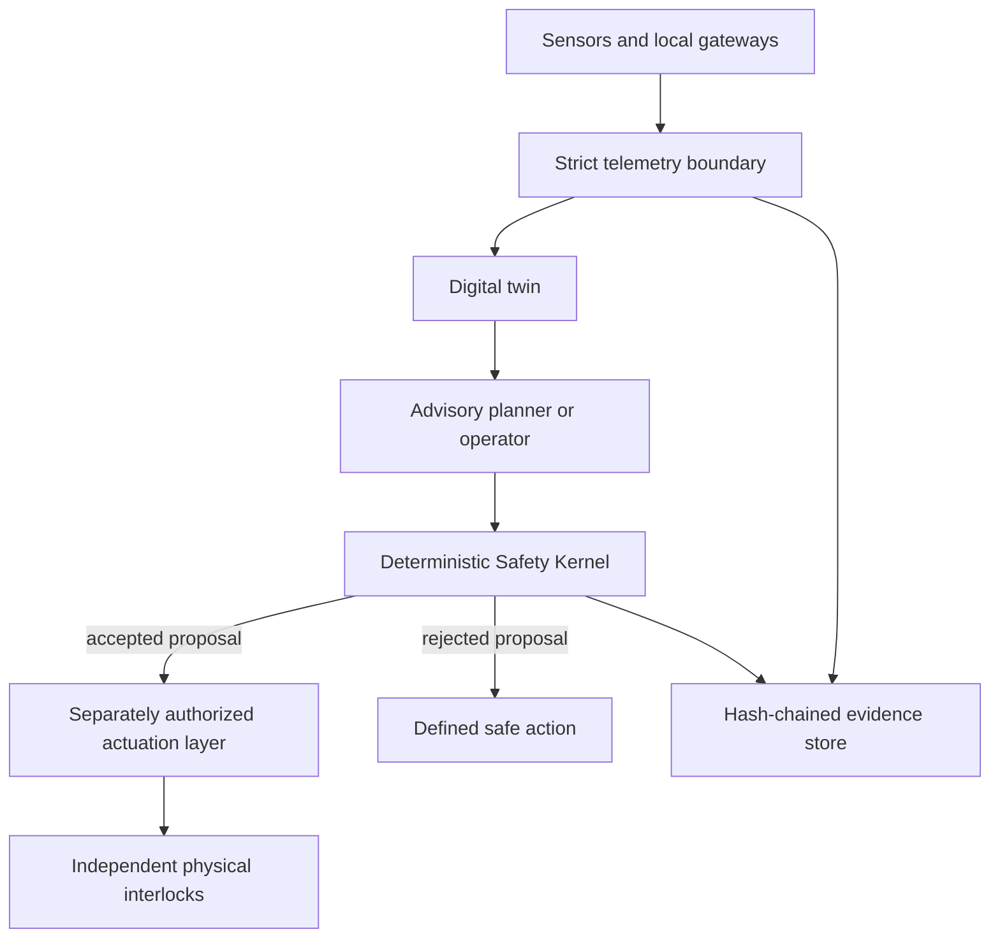

# Proposed software contract - not implemented

**Status corrected 3 November 2026. Architect: Vadym Tsinderhoz.**

The text below is preserved from the earlier README as an implementation target and historical record. Its commands, numeric examples, inventories, implementation statements and test counts are **unverified proposed requirements**, not evidence of working software. The referenced source files and tests were not present in the repository or either inspected historical commit. Do not run the examples as if a package were supplied.

---

## Original proposed implementation description

**Federated Autonomous Resilience Infrastructure — executable reference implementation**


- System Architect: **Vadym Tsinderhoz**
- Architecture version: **1.0.0**
- Document baseline: **TP-2026-RD-001**
- Status: **research and development reference implementation; not certified**

## What this repository is

The Tsinderhoz Proposal is a civilian, federated system-of-systems architecture for maintaining essential human services during routine operation, scarcity, infrastructure failure, and recovery. It connects energy, water, shelter, repair, mobility, sensing, communications, data, deterministic safety controls, cybersecurity, community authority, food support, logistics, environmental stewardship, maintenance, and assurance.

This repository turns the 115-page proposal into a real executable reference layer. It includes:

- a strict RD-100 configuration and independently testable engineering calculations;
- a thread-safe digital twin that rejects replayed and time-reversed telemetry;
- a deterministic Safety Kernel that fails closed and returns explicit rule IDs;
- transparent service-tier allocation for scarce resources;
- a 24-hour photovoltaic and battery dispatch simulator;
- a canonical SHA-256 event chain and transactional SQLite persistence;
- an HTTP JSON API and command-line interface with no runtime dependencies;
- machine-readable registries for 16 domains, 128 requirements, 128 tests, 64 FMEA records, 40 interfaces, 36 equations, 30 Leonardo motif families, 8 deployment profiles, 67 glossary terms, and 24 references;
- JSON Schemas, Docker deployment, continuous integration, security scanning, operational guidance, and the controlled English PDF.

The repository is deliberately honest about its boundary: it is a **working supervisory, modelling, evidence, and assurance implementation**. It is not a physical microgrid, water-treatment train, robot, medical device, building design, safety PLC, or regulatory approval. It never claims that software alone can make life-critical infrastructure safe.

## Why it can help people

The architecture is intended to help communities preserve understandable minimum service when ordinary infrastructure is constrained:

- keep protected energy available for water, communications, clinical cold chain, and safe shutdown;
- prevent untreated or uncertain water from being released merely because an optimization system requests it;
- make resource-allocation rules visible, reviewable, and independent of input ordering;
- give local operators a usable offline state while external networks or cloud services are unavailable;
- preserve evidence showing what the system knew, what it proposed, which barrier accepted or rejected it, and why;
- connect maintenance, spares, tests, interfaces, and residual risk to specific requirements instead of vague claims;
- support small pilots that can be disproved safely before any high-consequence deployment.

## What runs today

| Capability | Implemented here | Important limit |
|---|---:|---|
| RD-100 energy and water sizing | Yes | First-pass values require measured site inputs |
| PV/battery reference-day simulation | Yes | Not a bankable hourly/seasonal production model |
| Telemetry state twin | Yes | Uses explicit adapters; no vendor protocol driver is assumed |
| Deterministic command screening | Yes | Does not actuate equipment or replace physical protection |
| Water, battery, bus, robot, mode and stop barriers | Yes | Project-specific hazards require additional released rules |
| Append-only evidence history | Yes | SHA-256 detects alteration; it does not prove the source was truthful |
| SQLite event and evidence persistence | Yes | Production replication, backup, access control and retention must be engineered |
| HTTP API and CLI | Yes | Reference transport; deploy behind authenticated network controls |
| Requirement/test traceability | Yes | Baseline coverage is not certification evidence |
| Physical plant, permits and conformity | No | Must be supplied by competent local projects and authorities |

## Quick start

Python 3.11 or newer is required. Runtime operation uses only the Python standard library.

```bash
git clone https://github.com/Vados992/Tsinderhoz-proposal.git
cd Tsinderhoz-proposal
python3 -m venv .venv
. .venv/bin/activate
python -m pip install --no-deps -e .
tsinderhoz --config config/system.json self-check --data-dir data
```

Windows PowerShell activation:

```powershell
py -3.12 -m venv .venv
.\.venv\Scripts\Activate.ps1
python -m pip install --no-deps -e .
tsinderhoz --config config\system.json self-check --data-dir data
```

Expected top-level result:

```json
{
  "passed": true,
  "numeric_checks_passed": true,
  "safe_command_allowed": true,
  "unsafe_command_rejected": true
}
```

## Reproduce the reference calculations

```bash
tsinderhoz --config config/system.json rd100
```

The controlled RD-100 inputs produce:

| Result | Value |
|---|---:|
| PV rating | 106.837607 kWp |
| Average-day PV energy under stated assumptions | 375.000000 kWh/day |
| Nominal battery energy | 498.670213 kWh |
| Net delivered water demand | 7.000000 m³/day |
| Gross produced water demand | 7.777778 m³/day |
| Usable storage basis | 15.555556 m³ |

The 375 kWh/day PV value contains the stated 1.25 design margin. It is not a promise of surplus, seasonal autonomy, black-start success, converter adequacy, or reliability.

Run the illustrative day simulation:

```bash
tsinderhoz --config config/system.json simulate-day
```

## Run the API

```bash
tsinderhoz --config config/system.json serve \
  --host 127.0.0.1 \
  --port 8080 \
  --database runtime/tsinderhoz.sqlite3
```

In another terminal, submit telemetry and then ask the Safety Kernel to evaluate a command:

```bash
curl -sS -X POST http://127.0.0.1:8080/v1/telemetry \
  -H 'Content-Type: application/json' \
  --data-binary @examples/telemetry.json

curl -sS -X POST http://127.0.0.1:8080/v1/commands/evaluate \
  -H 'Content-Type: application/json' \
  --data-binary @examples/command-safe.json
```

The static example timestamps are documentary. For a live call, replace `observed_at` and `requested_at` with current timezone-aware timestamps; otherwise the stale-data barrier will correctly reject the non-stop command.

Available endpoints:

| Method | Path | Purpose |
|---|---|---|
| `GET` | `/health` | Process and configuration identity |
| `GET` | `/v1/reference/rd100` | Released reference inputs |
| `GET` | `/v1/state` | Latest accepted twin state |
| `GET` | `/v1/audit/verify` | Hash-chain validity and head |
| `POST` | `/v1/telemetry` | Strict telemetry ingestion |
| `POST` | `/v1/commands/evaluate` | Deterministic barrier evaluation |

See [docs/API.md](docs/API.md) and [schemas](schemas/) for complete contracts.

## Runtime architecture



The Safety Kernel is beneath optimization and AI. An AI system may propose a command; it cannot grant itself authority, change released limits, suppress independent trips, or turn missing evidence into a pass.

## Repository map

```text
src/tsinderhoz/     Executable reference engine
tests/              Unit, integration, persistence, API and simulation tests
config/             Controlled RD-100 and safety limits
data/               Machine-readable proposal registries plus hash manifest
schemas/            JSON Schema boundary contracts
examples/           Valid and deliberately rejected request examples
docs/               Architecture, safety, operations, validation and PDF
tools/              Reproducible registry export and repository checks
.github/workflows/  CI and CodeQL definitions
```

## Verification

Run the full local gate:

```bash
make validate
```

It performs source compilation, JSON parsing, registry digest verification, one-to-one requirement/test traceability, 42 unit and integration tests, and the executable self-check. The CI workflow repeats this on Python 3.11 and 3.12 and builds the container image.

## Controlled registries

`data/registry_manifest.json` records row counts, byte counts, and SHA-256 values for each exported registry. Regenerate only from the controlled source:

```bash
python -m pip install 'reportlab>=4,<5'
python tools/export_proposal_data.py
make validate
```

Changing a CSV manually invalidates the manifest. A legitimate change updates the source baseline, regenerates all affected registries, explains the rationale, and reruns affected validation.

## Safety contract

Never connect this repository directly to high-consequence equipment without a project-specific safety lifecycle. At minimum, a real deployment requires:

1. a lawful need and no-build comparison;
2. site survey, hazard analysis and environmental assessment;
3. competent electrical, structural, water, fire, radio, occupational and accessibility design;
4. independent physical protection and local stops;
5. authenticated and segmented operational networks;
6. calibrated instruments, defined uncertainty and time synchronization;
7. verified adapters and command semantics;
8. staged factory, integration, site, degraded-mode and emergency testing;
9. independent acceptance proportional to consequence;
10. trained staffing, spares, incident response, public communication, funding and end-of-life responsibility.

Read [docs/SAFETY_CASE.md](docs/SAFETY_CASE.md) and [docs/REAL_WORLD_LIMITS.md](docs/REAL_WORLD_LIMITS.md) before adapting any code.

## Intellectual property and citation

This is a **publicly visible, source-available research repository**, not an open-source release. The included proprietary license grants no production, commercial, redistribution, or derivative-work rights without prior written permission. Public visibility cannot technically prevent copying; authorship, commit history, controlled documents, hashes, and `CITATION.cff` create a clear provenance record.

Preferred citation:

> Vadym Tsinderhoz. *Tsinderhoz Proposal: Federated Autonomous Resilience Infrastructure — Executable Reference Implementation*, version 1.0.0, 2026.

See [LICENSE](LICENSE), [NOTICE.md](NOTICE.md), and [CITATION.cff](CITATION.cff).

## Author

**Vadym Tsinderhoz — System Architect**

The project is oriented toward practical human benefit: reducing preventable service loss, protecting vulnerable people during scarcity, and making critical decisions traceable, contestable, and safer.
